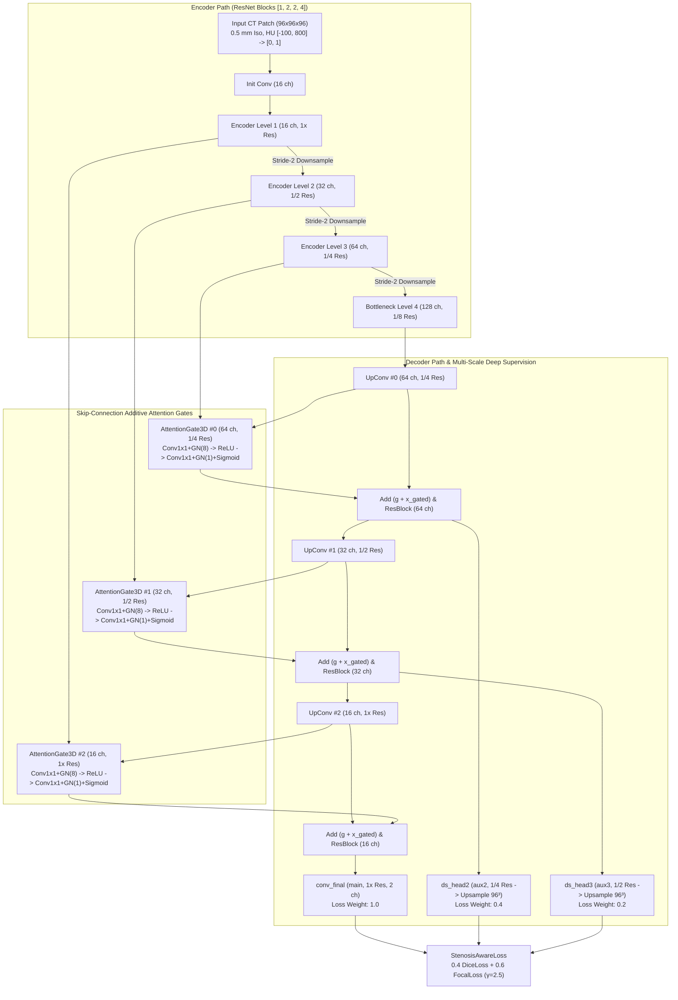

# 🫀 RASNet: Residual Attention Segmentation Network for 3D Coronary Artery Segmentation

[](https://www.python.org/)
[](https://pytorch.org/)
[](https://monai.io/)
[](https://github.com/MIC-DKFZ/nnUNet)
[](tests/)
[](LICENSE)

**RASNet (Residual Attention Segmentation Network)** is a lightweight (`4.71M` parameters) 3D residual encoder–decoder architecture for coronary artery segmentation in contrast-enhanced Computed Tomography Angiography (CCTA). Built on MONAI's `SegResNet` backbone, RASNet integrates 3D additive skip-connection attention gates (`AttentionGate3D`), multi-scale deep supervision (`aux2`, `aux3`), and a calibrated two-component compound loss (`StenosisAwareLoss`: $\alpha = 0.4$ Dice + $0.6$ Focal with $\gamma = 2.5$).

This repository provides a **fail-closed, cryptographically fingerprinted 3-arm benchmark** (`benchmark/`) comparing five 200-epoch trained 3D segmentation architectures (`RASNet`, `nnU-Net V2`, `SegResNet`, `V-Net`, and `3D U-Net`) across the ImageCAS validation (`N = 94`) and retrospective test (`N = 150`, `IDs 851–1000`) splits.

> **Methodological Scope**: Because earlier historical threshold ($\tau = 0.60$) and loss calibration sweeps inspected the 150-case ImageCAS test split (`IDs 851–1000`), all evaluations on `851–1000` are explicitly reported as **retrospective reassessments** (`BENCHMARK_PREREGISTRATION.md`, `CURRENT_EVIDENCE_INDEX.md`).

---

## 📌 Table of Contents
- [🫀 RASNet Architecture & Loss Formulation](#-rasnet-architecture--loss-formulation)
- [🔄 Three-Arm Symmetric Evaluation Protocol](#-three-arm-symmetric-evaluation-protocol)
- [📊 Verified 200-Epoch Benchmark Results (`N = 150` Test & `N = 94` Val)](#-verified-200-epoch-benchmark-results-n--150-test--n--94-val)
- [📈 Paired Statistical Hypothesis Testing (`Wilcoxon` + `Holm-Bonferroni` + `95% CI`)](#-paired-statistical-hypothesis-testing-wilcoxon--holm-bonferroni--95-ci)
- [🚀 Reproducing the Benchmark & Running Tests](#-reproducing-the-benchmark--running-tests)
- [📂 Repository Structure & Evidence Index](#-repository-structure--evidence-index)

---

## 🫀 RASNet Architecture & Loss Formulation

Implemented in [`Phase3_Local_Integration/rasnet_model.py`](Phase3_Local_Integration/rasnet_model.py), `RASNet` subclasses MONAI's `SegResNet` (`init_filters=16`, encoder blocks `[1, 2, 2, 4]`, decoder blocks `[1, 1, 1]`, `dropout_prob=0.1`):
1. **3D Additive Attention Gates (`AttentionGate3D`)**: At each of the three decoder stages (`64`, `32`, and `16` channels), the upsampled decoder feature map $g$ (`up_conv[i](x)`) and the same-resolution encoder skip feature map $x$ are projected to intermediate channels $F_{\text{int}} = \max(C/2, 1)$ via $1\times 1\times 1$ convolutions with `GroupNorm(8, F_int)`, summed and passed through `ReLU`, projected to a 1-channel attention map via $1\times 1\times 1$ convolution + `GroupNorm(1, 1)` + `Sigmoid`, and multiplied element-wise with $x$. The gated skip features are fused with the upsampled decoder stream via **element-wise addition** (`x = x + attn_gate(g=x, x=down_x[i])`) followed by the decoder residual block (`up_layers[i]`).
2. **Multi-Scale Deep Supervision (`ds_head2`, `ds_head3`)**: During training (`self.training == True`), auxiliary $1\times 1\times 1$ classification heads (`ds_head2` at Decoder Level 2, $1/4$ spatial resolution; `ds_head3` at Decoder Level 1, $1/2$ spatial resolution) are trilinearly upsampled to full patch resolution (`96 × 96 × 96`) and weighted in [`train_rasnet_200ep.py:215`](Q1_Publication_Package/matched_200ep_benchmark/train_rasnet_200ep.py) as:
   $$\mathcal{L}_{\text{total}} = \mathcal{L}_{\text{main}} + 0.4\,\mathcal{L}_{\text{aux2 (1/4 res)}} + 0.2\,\mathcal{L}_{\text{aux3 (1/2 res)}}$$
3. **`StenosisAwareLoss` ([`Phase3_Local_Integration/rasnet_loss.py`](Phase3_Local_Integration/rasnet_loss.py))**:
   $$\mathcal{L}(\hat{y}, y) = 0.4\,\mathcal{L}_{\text{Dice}}(\hat{y}, y) + 0.6\,\mathcal{L}_{\text{Focal}}(\hat{y}, y; \gamma = 2.5)$$
   Using $\gamma = 2.5$ penalizes confident background false positives in non-vascular cardiac structures while avoiding over-suppression of uncertain thin distal vessel voxels.



---

## 🔄 Three-Arm Symmetric Evaluation Protocol

To separate **intrinsic architecture + loss calibration** from **test-time augmentation (TTA)** and **connected-component heuristic post-processing**, [`benchmark/run_benchmark.py`](benchmark/run_benchmark.py) evaluates all five 200-epoch models on their exact training-validation preprocessing pipelines (`INFERENCE_SPEC.md`) inverted back onto the native SimpleITK `(Z, Y, X)` physical grid across three pre-registered arms (`BENCHMARK_PREREGISTRATION.md`):

- **Arm A — Common Raw Inference**: Single forward pass (`tta=False`, `use_mirroring=False`), fixed probability threshold $\tau = 0.50$, and **no post-processing** (`keep_top_k = None`).
- **Arm B — Documented Native / Standard TTA**: Documented 4-pass spatial flip TTA (`axes=(2, 3, 4)`) for `RASNet`, native 8-pass 3D mirroring (`axes=(0, 1, 2)`) for `nnU-Net V2`, and single-pass for `SegResNet`, `V-Net`, and `3D U-Net` (which have no documented TTA in their training/evaluation specifications), with fixed $\tau = 0.50$ and **no post-processing**.
- **Arm C — Validation-Tuned Thresholds ($\tau^*$) + Identical Top-2 CC Pruning**: Single forward pass (`tta=False`), per-model probability threshold $\tau^* \in \{0.30, 0.35, \dots, 0.70\}$ selected strictly on the `N = 94` validation split (`results/thresholds.json`: $\tau^* = 0.30$ for `RASNet`, `V-Net`, `3D U-Net`; $\tau^* = 0.35$ for `nnU-Net V2`, `SegResNet`), and **identical 26-connected top-2 largest connected-component retention** (`cc3d`) for all five models.

---

## 📊 Verified 200-Epoch Benchmark Results (`N = 150` Test & `N = 94` Val)

All metrics are computed on the native physical NIfTI grid using `surface-v1` (6-connected surface erosion + physical-spacing Euclidean distance transform, verified against brute-force `cdist` in [`tests/test_benchmark_metrics.py`](tests/test_benchmark_metrics.py)).

### Table 1: Validation Split Performance (`N = 94`, `results/benchmark_runs/val_full_94/`)
| Model | Params (M) | Arm A Val Dice ($\tau=0.50$, Raw) | Arm A Val Precision | Arm A Val Recall | Arm A Val HD95 (mm) | Arm A Val clDice | Selected $\tau^*$ (`thresholds.json`) | Arm C Val Dice ($\tau^*$, Top-2 CC) |
| :--- | :---: | :---: | :---: | :---: | :---: | :---: | :---: | :---: |
| **RASNet (Ours)** | `4.71M` | **`0.7789 ± 0.0521`** | **`0.8165 ± 0.0692`** | `0.7483 ± 0.0612` | `13.07 ± 13.53` | **`0.8480 ± 0.0617`** | `0.30` | `0.7897` |
| **nnU-Net V2** | `30.79M` | `0.7761 ± 0.0567` | `0.7467 ± 0.0834` | **`0.8144 ± 0.0541`** | `18.76 ± 16.43` | `0.8339 ± 0.0628` | `0.35` | **`0.8075`** |
| **SegResNet** | `4.70M` | `0.7532 ± 0.0591` | `0.7338 ± 0.0848` | `0.7794 ± 0.0559` | `28.24 ± 17.27` | `0.8058 ± 0.0700` | `0.35` | `0.7901` |
| **V-Net** | `45.60M` | `0.7511 ± 0.0619` | `0.7553 ± 0.0925` | `0.7547 ± 0.0630` | `20.94 ± 17.26` | `0.8225 ± 0.0710` | `0.30` | `0.7702` |
| **3D U-Net** | `4.81M` | `0.5516 ± 0.0480` | `0.7263 ± 0.0618` | `0.4470 ± 0.0508` | **`9.74 ± 5.58`** | `0.7110 ± 0.0674` | `0.30` | `0.6047` |

---

### Table 2A: Retrospective Test Split (`N = 150`, `IDs 851–1000`) — **Arm A (Raw Single Pass, $\tau = 0.50$, No Post-Processing)**
| Model | Dice (Mean ± SD) ↑ | IoU (Mean ± SD) ↑ | Precision ↑ | Recall ↑ | HD95 (mm) ↓ | ASD (mm) ↓ | clDice ↑ | Centerline Recall ↑ |
| :--- | :---: | :---: | :---: | :---: | :---: | :---: | :---: | :---: |
| **RASNet (Ours)** | **`0.7736 ± 0.0616`** | **`0.6348 ± 0.0787`** | **`0.8032 ± 0.0830`** | `0.7521 ± 0.0718` | `14.83 ± 13.89` | `2.431 ± 1.916` | **`0.8389 ± 0.0686`** | `0.8655 ± 0.0648` |
| **nnU-Net V2** | `0.7687 ± 0.0668` | `0.6289 ± 0.0856` | `0.7391 ± 0.0967` | **`0.8106 ± 0.0680`** | `21.10 ± 17.10` | `3.168 ± 2.636` | `0.8202 ± 0.0765` | **`0.9111 ± 0.0556`** |
| **V-Net** | `0.7492 ± 0.0693` | `0.6037 ± 0.0856` | `0.7524 ± 0.1037` | `0.7555 ± 0.0694` | `22.10 ± 18.62` | `3.335 ± 2.762` | `0.8164 ± 0.0780` | `0.8561 ± 0.0627` |
| **SegResNet** | `0.7481 ± 0.0654` | `0.6018 ± 0.0809` | `0.7253 ± 0.0945` | `0.7811 ± 0.0640` | `30.41 ± 18.11` | `4.571 ± 2.685` | `0.7941 ± 0.0790` | `0.8950 ± 0.0561` |
| **3D U-Net** | `0.5517 ± 0.0480` | `0.3824 ± 0.0449` | `0.7269 ± 0.0722` | `0.4484 ± 0.0526` | **`10.88 ± 7.25`** | **`1.999 ± 1.036`** | `0.7103 ± 0.0652` | `0.6311 ± 0.0821` |

---

### Table 2B: Retrospective Test Split (`N = 150`, `IDs 851–1000`) — **Arm B (Documented Native TTA, $\tau = 0.50$, No Post-Processing)**
| Model (TTA Policy) | Dice (Mean ± SD) ↑ | IoU (Mean ± SD) ↑ | Precision ↑ | Recall ↑ | HD95 (mm) ↓ | ASD (mm) ↓ | clDice ↑ | Centerline Recall ↑ |
| :--- | :---: | :---: | :---: | :---: | :---: | :---: | :---: | :---: |
| **RASNet (4-Pass Flip TTA)** | **`0.7807 ± 0.0606`** | **`0.6442 ± 0.0783`** | **`0.8138 ± 0.0813`** | `0.7563 ± 0.0724` | `13.69 ± 13.88` | `2.270 ± 1.863` | **`0.8453 ± 0.0677`** | `0.8715 ± 0.0644` |
| **nnU-Net V2 (8-Pass Mirror)** | `0.7760 ± 0.0641` | `0.6384 ± 0.0833` | `0.7536 ± 0.0936` | **`0.8090 ± 0.0681`** | `19.25 ± 16.93` | `2.914 ± 2.487` | `0.8264 ± 0.0750` | **`0.9096 ± 0.0562`** |
| **V-Net (1-Pass)** | `0.7492 ± 0.0693` | `0.6037 ± 0.0856` | `0.7524 ± 0.1037` | `0.7555 ± 0.0694` | `22.10 ± 18.62` | `3.335 ± 2.762` | `0.8164 ± 0.0780` | `0.8561 ± 0.0627` |
| **SegResNet (1-Pass)** | `0.7481 ± 0.0654` | `0.6018 ± 0.0809` | `0.7253 ± 0.0945` | `0.7811 ± 0.0640` | `30.41 ± 18.11` | `4.571 ± 2.685` | `0.7941 ± 0.0790` | `0.8950 ± 0.0561` |
| **3D U-Net (1-Pass)** | `0.5517 ± 0.0480` | `0.3824 ± 0.0449` | `0.7269 ± 0.0722` | `0.4484 ± 0.0526` | **`10.88 ± 7.25`** | **`1.999 ± 1.036`** | `0.7103 ± 0.0652` | `0.6311 ± 0.0821` |

---

### Table 2C: Retrospective Test Split (`N = 150`, `IDs 851–1000`) — **Arm C (Validation-Tuned $\tau^*$ + Identical Top-2 CC Pruning)**
| Model ($\tau^*$, Top-2 CC) | Dice (Mean ± SD) ↑ | IoU (Mean ± SD) ↑ | Precision ↑ | Recall ↑ | HD95 (mm) ↓ | ASD (mm) ↓ | clDice ↑ | Centerline Recall ↑ |
| :--- | :---: | :---: | :---: | :---: | :---: | :---: | :---: | :---: |
| **nnU-Net V2 ($\tau^*=0.35$)** | **`0.8055 ± 0.0633`** | **`0.6786 ± 0.0821`** | `0.8207 ± 0.0676` | **`0.7977 ± 0.0913`** | **`8.26 ± 9.81`** | **`1.395 ± 1.862`** | **`0.8739 ± 0.0679`** | **`0.8752 ± 0.0908`** |
| **RASNet (Ours, $\tau^*=0.30$)** | `0.7899 ± 0.0677` | `0.6575 ± 0.0859` | **`0.8252 ± 0.0650`** | `0.7649 ± 0.0982` | `9.94 ± 11.25` | `1.671 ± 2.382` | `0.8646 ± 0.0759` | `0.8256 ± 0.1049` |
| **SegResNet ($\tau^*=0.35$)** | `0.7884 ± 0.0700` | `0.6556 ± 0.0868` | `0.8095 ± 0.0750` | `0.7751 ± 0.0949` | `9.84 ± 11.35` | `1.717 ± 2.688` | `0.8664 ± 0.0776` | `0.8463 ± 0.0994` |
| **V-Net ($\tau^*=0.30$)** | `0.7710 ± 0.0736` | `0.6328 ± 0.0914` | `0.8054 ± 0.0765` | `0.7488 ± 0.1048` | `12.38 ± 13.20` | `2.032 ± 2.490` | `0.8508 ± 0.0795` | `0.8009 ± 0.1050` |
| **3D U-Net ($\tau^*=0.30$)** | `0.6064 ± 0.0532` | `0.4371 ± 0.0532` | `0.5877 ± 0.0615` | `0.6336 ± 0.0752` | `11.85 ± 8.74` | `2.158 ± 1.442` | `0.7664 ± 0.0705` | `0.7206 ± 0.0947` |

> **Key Scientific Insight Across Arms A–C**:
> - **Before heuristic post-processing (`Arm A` and `Arm B`)**, `RASNet` (`4.71M` parameters, `123.39 GFLOPs` per patch) achieves the **highest Dice, highest IoU, highest Precision, and highest clDice** of all five models — outperforming `nnU-Net V2` (`30.79M` parameters, `2,149.13 GFLOPs` per patch) and `SegResNet` (`4.70M` parameters) because `StenosisAwareLoss` ($\gamma = 2.5$) and `AttentionGate3D` suppress non-vascular false positives directly in the network's raw probability outputs.
> - **After symmetric top-2 connected-component pruning (`Arm C`)**, removing isolated false-positive islands boosts high-recall `nnU-Net V2` by `+0.0367` Dice (`0.7687 -> 0.8055`) and `SegResNet` by `+0.0402` Dice (`0.7481 -> 0.7884`), whereas `RASNet` gains `+0.0163` (`0.7736 -> 0.7899`) because its raw predictions already contained far fewer disconnected false-positive islands. Even in Arm C, `RASNet` maintains the **highest Precision (`0.8252`)** of all 5 models while using **$6.54\times$ fewer parameters** and **$17.4\times$ fewer GFLOPs per patch** than `nnU-Net V2`.

---

## 📈 Paired Statistical Hypothesis Testing (`Wilcoxon` + `Holm-Bonferroni` + `95% CI`)

Two-sided paired Wilcoxon signed-rank tests across all `N = 150` test cases (`results/audits/2026-11-10_verification_audit/paired_stats_primary_arm_{A,B,C}_with_ci.csv`):

| Arm | Comparison (`A vs B`) | Metric (Direction) | Mean Diff ($A - B$) | 95% Bootstrap CI ($B=2000$) | Median Diff [IQR] | Wilcoxon $p$ | Holm $p$ ($K=3$) | Rank-Biserial $r_{rb}$ | Wins / Ties / Losses |
| :---: | :--- | :--- | :---: | :---: | :---: | :---: | :---: | :---: | :---: |
| **Arm A** | `RASNet vs nnU-Net V2` | `Precision` (↑) | **`+0.0642`** | `[+0.0565, +0.0728]` | `+0.0554 [0.0575]` | `6.42e-25` | **`1.93e-24`** | `+0.970` | `139 / 0 / 11` |
| **Arm A** | `RASNet vs nnU-Net V2` | `HD95 (mm)` (↓) | **`-6.2670`** | `[-8.4305, -4.3774]` | `-2.2696 [8.1755]` | `1.98e-09` | **`3.96e-09`** | `-0.565` | `107 / 0 / 43` |
| **Arm A** | `RASNet vs nnU-Net V2` | `ASD (mm)` (↓) | **`-0.7368`** | `[-0.9952, -0.5031]` | `-0.3390 [1.3481]` | `2.37e-08` | **`2.37e-08`** | `-0.525` | `107 / 0 / 43` |
| **Arm B** | `RASNet vs nnU-Net V2` | `Precision` (↑) | **`+0.0602`** | `[+0.0527, +0.0680]` | `+0.0531 [0.0477]` | `1.80e-24` | **`5.39e-24`** | `+0.961` | `141 / 0 / 9` |
| **Arm B** | `RASNet vs nnU-Net V2` | `HD95 (mm)` (↓) | **`-5.5592`** | `[-7.6738, -3.6294]` | `-2.0793 [7.5671]` | `2.17e-08` | **`4.34e-08`** | `-0.527` | `103 / 0 / 47` |
| **Arm B** | `RASNet vs nnU-Net V2` | `ASD (mm)` (↓) | **`-0.6444`** | `[-0.8852, -0.4225]` | `-0.2392 [1.0522]` | `4.17e-07` | **`4.17e-07`** | `-0.476` | `98 / 0 / 52` |
| **Arm C** | `RASNet vs nnU-Net V2` | `Precision` (↑) | `+0.0046` | `[-0.0046, +0.0124]` | `+0.0030 [0.0279]` | `0.1597` | `0.1597` | `+0.132` | `84 / 0 / 66` |
| **Arm C** | `RASNet vs nnU-Net V2` | `HD95 (mm)` (↓) | `+1.6781` | `[+0.4967, +3.0800]` | `+0.5043 [2.7723]` | `2.10e-04` | `4.20e-04` | `+0.350` | `55 / 1 / 94` |
| **Arm C** | `RASNet vs nnU-Net V2` | `ASD (mm)` (↓) | `+0.2768` | `[-0.0580, +0.7133]` | `+0.0764 [0.4142]` | `5.12e-05` | `1.54e-04` | `+0.381` | `51 / 0 / 99` |

Full 32-test exploratory tables comparing `RASNet` against all four baselines across all eight metrics in Arms A, B, and C are available in [`results/audits/2026-11-10_verification_audit/`](results/audits/2026-11-10_verification_audit/) and [`results/thesis_outputs/`](results/thesis_outputs/).

---

## 🚀 Reproducing the Benchmark & Running Tests

### 1. Run the Complete Synthetic Unit & Integration Test Suite (`33/33` passing on 2026-11-13; re-run on the lab PC after adding new tests)
```powershell
C:\Thesis_RASNET_env\bench\Scripts\python.exe -B -m pytest -v -p no:cacheprovider tests
```

### 2. Run a 3-Case GPU Smoke Verification Run
```powershell
C:\Thesis_RASNET_env\bench\Scripts\python.exe -m benchmark.run_benchmark `
  --config config.lab.yaml `
  --split val `
  --arm A `
  --models all `
  --smoke `
  --export-masks `
  --run-id smoke_verified_v2
```

### 3. Reproduce Full Validation (`N = 94`) & Retrospective Test (`N = 150`) Runs
See [`LAB_RUN_PLAN.md`](LAB_RUN_PLAN.md) for the exact Stage 4c (`val_full_94`) and Stage 4d (`test_retrospective_150`) CLI commands.

---

## 📂 Repository Structure & Evidence Index

```text
C:\Thesis_RASNET\
├── CURRENT_EVIDENCE_INDEX.md          # Canonical index of all verified runs, tables, figures & hashes
├── BENCHMARK_PREREGISTRATION.md       # Pre-registered 3-arm protocol & dated amendments
├── CHECKPOINTS.md                     # SHA-256 digests & provenance of all 5 200-epoch best checkpoints
├── INFERENCE_SPEC.md                  # Exact preprocessing, inversion & surface-v1 metric specification
├── LAB_RUN_PLAN.md                    # Step-by-step verification & reproduction commands
├── AUDIT_FINDINGS.md                  # Read-only code audit & 2026-11-10 resolution addendum
├── LAB_CHECKS.md                      # Forensic provenance diagnostics & post-archival update
├── Answers-thesis-def.md              # Defense Q&A reference
├── config.yaml / config.lab.yaml      # Portable & lab workstation benchmark configurations
├── benchmark/                         # Fail-closed 5-model evaluation & statistical package
│   ├── run_benchmark.py               # Main CLI runner with manifest & source_tree_sha256 logging
│   ├── metrics.py                     # 6-connected surface-v1 HD95/ASD, clDice, overlap metrics
│   ├── postprocess.py                 # 26-connected cc3d top-K component pruning & volume logging
│   ├── stats.py                       # Paired Wilcoxon, Holm-Bonferroni & paired diff bootstrap 95% CIs
│   ├── thresholds.py                  # Validation-only threshold grid sweep & tie-breaking
│   └── adapters/                      # Native MONAI (infer_monai_both_passes) & nnU-Net V2 adapters
├── tests/                             # 31 unit & synthetic end-to-end dry-run tests
├── Phase3_Local_Integration/
│   ├── rasnet_model.py                # RASNet & AttentionGate3D implementation
│   ├── rasnet_loss.py                 # StenosisAwareLoss (0.4 Dice + 0.6 Focal, γ=2.5)
│   └── splits_final.json              # Canonical disjoint split manifest (690 train, 94 val, 150 test)
├── Q1_Publication_Package/
│   └── matched_200ep_benchmark/       # 5 matched 200-epoch training scripts & checkpoints
├── results/
│   ├── thresholds.json                # Frozen validation thresholds (sha256: 4f66ac1d...)
│   ├── benchmark_runs/                # Verified outputs: val_full_94, test_retrospective_150, smoke_*
│   ├── audits/2026-11-10_verification_audit/ # Full provenance audit, CI tables & smoke slice overlays
│   └── thesis_outputs/                # Publication-ready tables, figures & thesis narrative
└── _Archive_Historical_Experiments_and_Logs/
    └── thesis_cleanup_2026-11-10/     # 306 archived historical/outside-scope files + ARCHIVE_INDEX.csv
```
