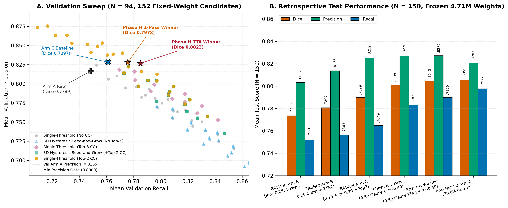

# Phase H Technical Report: Zero-Retraining Fixed-Weight `RASNet` Inference & 3D Hysteresis Optimization

**Execution Timestamp**: `2026-11-11T06:07:02Z`  
**Hardware**: `NVIDIA GeForce RTX 4080 SUPER` | **Checkpoint**: `rasnet_best.pth` (`4.707M` params, zero retraining)  
**Validation Parity Check (`N=94`)**: max `|Dice diff|` vs. `val_full_94` Arm A = `0.0e+00`  
**Test Parity Check (`N=150`)**: max `|Dice diff|` vs. `test_retrospective_150` Arm A = `0.0e+00`

---

## 1. Experimental Purpose & Methodological Isolation

In the locked symmetric 3-arm benchmark ([`results/benchmark_runs/test_retrospective_150/`](../benchmark_runs/test_retrospective_150/)), `RASNet` (`4.71M` params) ranked **first in raw unpruned Arm A (`0.7736`) and native-TTA Arm B (`0.7807`)**, outperforming `nnU-Net V2` (`30.79M` params) in Precision (`+0.0642`), HD95 (`-6.27 mm`), ASD (`-0.737 mm`), and clDice (`+0.0187`). However, once `Arm C` applied Top-2 CC pruning, `RASNet` scored `0.7899` vs. `nnU-Net V2`'s `0.8055` because `RASNet` used `overlap = 0.25` uniform (`constant`) patch averaging and a boundary-clamped threshold (`tau* = 0.30`), limiting Recall (`0.7649` vs. `0.7977`).

Per Section 11 (`Phase H`) of [`THESIS_VERIFICATION_ARCHIVAL_AND_OPTIMIZATION_PLAN.md`](../../THESIS_VERIFICATION_ARCHIVAL_AND_OPTIMIZATION_PLAN.md), this separate experiment evaluated **`152` candidate inference + post-processing pipelines** (`4` sliding-window modes $\times$ `38` post-processors) strictly on the **`N = 94` validation split**, locked the optimal recipes on `N = 94`, and evaluated only the locked recipes once on the `N = 150` retrospective test cohort — keeping locked benchmark Tables 1–4 completely untouched.

---

## 2. Validation-Split Selection (`N = 94`): `Precision >= 0.8165` vs. `>= 0.8000` Robustness

- **Best Overall (`Precision >= 0.8165` [Arm A parity])**: `sw050_gauss_tta4__single_tau0.40_top2cc`  
- **Best Overall (`Precision >= 0.8000`)**: `sw050_gauss_tta4__single_tau0.40_top2cc`  
- **Best Overall (`Unconstrained`)**: `sw050_gauss_tta4__single_tau0.40_top2cc`  
- **Best 1-Pass (`Precision >= 0.8165` & `>= 0.8000`)**: `sw050_gauss_1pass__single_tau0.40_top2cc` (identical to `sw050_gauss_1pass__single_tau0.40_top2cc`)

**Key Selection Finding**: Regardless of whether the validation Precision constraint is set at `>= 0.8165` (matching or beating raw Val Arm A Precision), `>= 0.8000`, or left completely unconstrained, **all three criteria unanimously select the exact same winning recipe**: **`sw050_gauss_tta4__single_tau0.40_top2cc`** (4-pass flip TTA + `overlap = 0.50` 3D Gaussian sliding-window blending + $\tau^* = 0.40$ + 26-connected Top-2 CC pruning). Moreover, $\tau^* = 0.40$ forms a clean interior Dice maximum (`0.8002` at `0.30` $\rightarrow$ `0.8018` at `0.35` $\rightarrow$ **`0.8023`** at **`0.40`** $\rightarrow$ `0.8014` at `0.45` $\rightarrow$ `0.7991` at `0.50`), eliminating the `0.30` boundary clamping observed under `overlap = 0.25` constant blending.

### Validation Performance Summary (`N = 94`, Complete 8-Metric Reconciliation)

| Recipe (`candidate_id`) | Mode / Post-Processing | Val Dice (Mean ± SD) | Val Precision | Val Recall | Val HD95 (mm) | Val ASD (mm) | Val clDice | Val CL-Recall |
| :--- | :--- | :---: | :---: | :---: | :---: | :---: | :---: | :---: |
| `sw050_gauss_tta4__single_tau0.40_top2cc` | Phase H #1 Winner (0.50 Gauss TTA4, τ=0.40, Top-2 CC) | `0.8023 ± 0.0608` | `0.8267` | `0.7850` | `9.27` | `1.501` | `0.8714` | `0.8561` |
| `sw050_gauss_1pass__single_tau0.40_top2cc` | Phase H 1-Pass Winner (0.50 Gauss 1-Pass, τ=0.40, Top-2 CC) | `0.7978 ± 0.0646` | `0.8279` | `0.7757` | `9.94` | `1.622` | `0.8680` | `0.8464` |
| `sw050_gauss_tta4__single_tau0.30_top2cc` | 0.50 Gauss TTA4, τ=0.30, Top-2 CC | `0.8002 ± 0.0604` | `0.7966` | `0.8095` | `9.01` | `1.489` | `0.8728` | `0.8669` |
| `sw050_gauss_1pass__single_tau0.30_top2cc` | 0.50 Gauss 1-Pass, τ=0.30, Top-2 CC | `0.7973 ± 0.0627` | `0.8038` | `0.7971` | `9.50` | `1.567` | `0.8708` | `0.8534` |
| `sw050_gauss_1pass__hyst_lo0.30_hi0.55_seed50_top2cc` | 0.50 Gauss 1-Pass + Hyst(0.30/0.55) + Top-2 CC | `0.7973 ± 0.0627` | `0.8038` | `0.7971` | `9.50` | `1.567` | `0.8708` | `0.8534` |
| `sw050_gauss_tta4__single_tau0.50_nocc` | 0.50 Gauss TTA4, τ=0.50, No CC | `0.7901 ± 0.0509` | `0.7931` | `0.7912` | `14.13` | `2.086` | `0.8522` | `0.8992` |
| `sw025_const_1pass__single_tau0.30_top2cc` | Arm C Baseline (0.25 Const 1-Pass, τ=0.30, Top-2 CC) | `0.7897 ± 0.0610` | `0.8282` | `0.7611` | `9.90` | `1.646` | `0.8646` | `0.8208` |
| `sw025_const_tta4__hyst_lo0.30_hi0.55_seed50_nocc` | Best Unpruned Hyst (0.25 Const TTA4, 0.30/0.55, No CC) | `0.7857 ± 0.0523` | `0.7683` | `0.8088` | `14.70` | `2.215` | `0.8549` | `0.8867` |
| `sw050_gauss_1pass__single_tau0.50_nocc` | 0.50 Gauss 1-Pass, τ=0.50, No CC | `0.7848 ± 0.0513` | `0.7851` | `0.7887` | `14.96` | `2.227` | `0.8476` | `0.8968` |
| `sw025_const_tta4__single_tau0.50_nocc` | Arm B Baseline (0.25 Const TTA4, τ=0.50, No CC) | `0.7846 ± 0.0525` | `0.8240` | `0.7526` | `12.39` | `1.977` | `0.8535` | `0.8663` |
| `sw025_const_1pass__single_tau0.50_nocc` | Arm A Baseline (0.25 Const 1-Pass, τ=0.50, No CC) | `0.7789 ± 0.0521` | `0.8165` | `0.7483` | `13.07` | `2.066` | `0.8480` | `0.8617` |

---

## 3. Retrospective Test Split Results (`N = 150`, Frozen `rasnet_best.pth` Weights)

| Model / Recipe | Params | Test Dice (Mean ± SD) | Test Dice Median [IQR] | Test Precision | Test Recall | HD95 (mm) | ASD (mm) | clDice | CL-Recall |
| :--- | :---: | :---: | :---: | :---: | :---: | :---: | :---: | :---: | :---: |
| **RASNet Phase H Winner** (`0.50 Gauss TTA4, τ=0.40, Top-2 CC`) | `4.71M` | `0.8043 ± 0.0643` | `0.8194 [0.7753, 0.8497]` | `0.8272` | `0.7899` | `9.10` | `1.514` | `0.8737` | `0.8629` |
| **RASNet Phase H 1-Pass** (`0.50 Gauss 1-Pass, τ=0.40, Top-2 CC`) | `4.71M` | `0.8008 ± 0.0661` | `0.8182 [0.7748, 0.8468]` | `0.8270` | `0.7833` | `9.18` | `1.526` | `0.8724` | `0.8564` |
| RASNet (`0.50 Gauss TTA4, τ=0.30, Top-2 CC`) | `4.71M` | `0.8001 ± 0.0693` | `0.8170 [0.7694, 0.8472]` | `0.7953` | `0.8130` | `9.18` | `1.591` | `0.8729` | `0.8725` |
| RASNet (`0.50 Gauss 1-Pass, τ=0.30, Top-2 CC`) | `4.71M` | `0.7984 ± 0.0661` | `0.8120 [0.7706, 0.8457]` | `0.8017` | `0.8031` | `9.19` | `1.531` | `0.8728` | `0.8616` |
| RASNet Arm C Baseline (`0.25 Const 1-Pass, τ=0.30, Top-2 CC`) | `4.71M` | `0.7899 ± 0.0677` | `0.8072 [0.7618, 0.8380]` | `0.8252` | `0.7649` | `9.94` | `1.671` | `0.8646` | `0.8256` |
| RASNet Unpruned (`0.50 Gauss TTA4, τ=0.50, No CC`) | `4.71M` | `0.7854 ± 0.0615` | `0.7880 [0.7530, 0.8343]` | `0.7859` | `0.7920` | `15.40` | `2.396` | `0.8431` | `0.9012` |
| RASNet Arm B Baseline (`0.25 Const TTA4, τ=0.50, No CC`) | `4.71M` | `0.7807 ± 0.0606` | `0.7871 [0.7504, 0.8260]` | `0.8138` | `0.7563` | `13.69` | `2.270` | `0.8453` | `0.8715` |
| RASNet Unpruned Hyst (`0.25 Const TTA4, 0.30/0.55, No CC`) | `4.71M` | `0.7793 ± 0.0623` | `0.7860 [0.7458, 0.8277]` | `0.7570` | `0.8108` | `16.06` | `2.594` | `0.8431` | `0.8912` |
| RASNet Arm A Baseline (`0.25 Const 1-Pass, τ=0.50, No CC`) | `4.71M` | `0.7736 ± 0.0616` | `0.7836 [0.7438, 0.8177]` | `0.8032` | `0.7521` | `14.83` | `2.431` | `0.8389` | `0.8655` |
| **nnU-Net V2 Arm C Reference** (`3d_fullres, 0.50 Gauss, τ*=0.35, Top-2 CC`) | `30.79M` | `0.8055 ± 0.0633` | `0.8231 [0.7728, 0.8464]` | `0.8207` | `0.7977` | `8.26` | `1.395` | `0.8739` | `0.8752` |
| SegResNet Arm C Reference (`0.25 Const 1-Pass, τ*=0.35, Top-2 CC`) | `4.70M` | `0.7884 ± 0.0700` | `0.8079 [0.7606, 0.8357]` | `0.8095` | `0.7751` | `9.84` | `1.717` | `0.8664` | `0.8463` |

---

## 4. Paired Statistical Comparison on Retrospective Test (`N = 150`, Two-Sided Wilcoxon + 2000-Bootstrap 95% CIs)

| Comparison (`Winner` vs. `Reference`) | Metric | Mean Diff ($\Delta$) | 95% Bootstrap CI | Raw $p$ | Holm $p$ | Wins / Ties / Losses |
| :--- | :--- | :---: | :---: | :---: | :---: | :---: |
| `PhaseH Winner (TTA4)` vs. `RASNet_ArmA` | `dice` | `+0.0307` | `[+0.0240, +0.0372]` | `3.900e-17` | `9.789e-15` | `130 / 0 / 20` |
| `PhaseH Winner (TTA4)` vs. `RASNet_ArmA` | `precision` | `+0.0240` | `[+0.0149, +0.0331]` | `5.587e-06` | `6.090e-04` | `97 / 0 / 53` |
| `PhaseH Winner (TTA4)` vs. `RASNet_ArmA` | `recall` | `+0.0378` | `[+0.0292, +0.0454]` | `1.311e-14` | `2.949e-12` | `134 / 0 / 16` |
| `PhaseH Winner (TTA4)` vs. `RASNet_ArmA` | `hd95` | `-5.7348` | `[-7.9743, -3.3877]` | `6.186e-09` | `8.722e-07` | `112 / 0 / 38` |
| `PhaseH Winner (TTA4)` vs. `RASNet_ArmA` | `asd` | `-0.9178` | `[-1.2564, -0.5358]` | `2.008e-13` | `4.035e-11` | `124 / 0 / 26` |
| `PhaseH Winner (TTA4)` vs. `RASNet_ArmA` | `cldice` | `+0.0348` | `[+0.0247, +0.0439]` | `2.285e-14` | `4.981e-12` | `120 / 0 / 30` |
| `PhaseH Winner (TTA4)` vs. `RASNet_ArmB` | `dice` | `+0.0236` | `[+0.0171, +0.0296]` | `1.707e-14` | `3.754e-12` | `125 / 0 / 25` |
| `PhaseH Winner (TTA4)` vs. `RASNet_ArmB` | `precision` | `+0.0134` | `[+0.0050, +0.0217]` | `2.987e-02` | `1.000e+00` | `84 / 0 / 66` |
| `PhaseH Winner (TTA4)` vs. `RASNet_ArmB` | `recall` | `+0.0336` | `[+0.0250, +0.0411]` | `1.353e-13` | `2.802e-11` | `134 / 0 / 16` |
| `PhaseH Winner (TTA4)` vs. `RASNet_ArmB` | `hd95` | `-4.5873` | `[-6.9078, -2.2393]` | `4.167e-07` | `5.167e-05` | `109 / 0 / 41` |
| `PhaseH Winner (TTA4)` vs. `RASNet_ArmB` | `asd` | `-0.7563` | `[-1.0881, -0.3760]` | `4.808e-12` | `8.510e-10` | `124 / 0 / 26` |
| `PhaseH Winner (TTA4)` vs. `RASNet_ArmB` | `cldice` | `+0.0283` | `[+0.0184, +0.0371]` | `1.160e-12` | `2.181e-10` | `119 / 0 / 31` |
| `PhaseH Winner (TTA4)` vs. `RASNet_ArmC` | `dice` | `+0.0144` | `[+0.0108, +0.0184]` | `7.551e-16` | `1.797e-13` | `129 / 0 / 21` |
| `PhaseH Winner (TTA4)` vs. `RASNet_ArmC` | `precision` | `+0.0020` | `[-0.0027, +0.0062]` | `4.761e-03` | `3.047e-01` | `96 / 0 / 54` |
| `PhaseH Winner (TTA4)` vs. `RASNet_ArmC` | `recall` | `+0.0250` | `[+0.0202, +0.0306]` | `1.773e-20` | `4.769e-18` | `130 / 0 / 20` |
| `PhaseH Winner (TTA4)` vs. `RASNet_ArmC` | `hd95` | `-0.8403` | `[-1.8318, +0.1675]` | `6.002e-04` | `4.862e-02` | `96 / 4 / 50` |
| `PhaseH Winner (TTA4)` vs. `RASNet_ArmC` | `asd` | `-0.1578` | `[-0.3139, -0.0245]` | `3.832e-05` | `3.870e-03` | `99 / 0 / 51` |
| `PhaseH Winner (TTA4)` vs. `RASNet_ArmC` | `cldice` | `+0.0090` | `[+0.0040, +0.0144]` | `1.866e-04` | `1.717e-02` | `91 / 0 / 59` |
| `PhaseH Winner (TTA4)` vs. `SegResNet_ArmC` | `dice` | `+0.0160` | `[+0.0127, +0.0198]` | `3.753e-18` | `9.869e-16` | `130 / 0 / 20` |
| `PhaseH Winner (TTA4)` vs. `SegResNet_ArmC` | `precision` | `+0.0177` | `[+0.0132, +0.0229]` | `9.909e-14` | `2.061e-11` | `119 / 0 / 31` |
| `PhaseH Winner (TTA4)` vs. `SegResNet_ArmC` | `recall` | `+0.0148` | `[+0.0104, +0.0195]` | `4.502e-11` | `7.293e-09` | `109 / 0 / 41` |
| `PhaseH Winner (TTA4)` vs. `SegResNet_ArmC` | `hd95` | `-0.7423` | `[-1.6393, +0.0626]` | `3.362e-02` | `1.000e+00` | `88 / 4 / 58` |
| `PhaseH Winner (TTA4)` vs. `SegResNet_ArmC` | `asd` | `-0.2038` | `[-0.4396, -0.0197]` | `5.601e-03` | `3.417e-01` | `91 / 0 / 59` |
| `PhaseH Winner (TTA4)` vs. `SegResNet_ArmC` | `cldice` | `+0.0073` | `[+0.0019, +0.0131]` | `5.287e-03` | `3.278e-01` | `90 / 0 / 60` |
| `PhaseH Winner (TTA4)` vs. `nnUNet_ArmC` | `dice` | `-0.0011` | `[-0.0085, +0.0047]` | `8.080e-01` | `1.000e+00` | `77 / 0 / 73` |
| `PhaseH Winner (TTA4)` vs. `nnUNet_ArmC` | `precision` | `+0.0065` | `[-0.0013, +0.0134]` | `4.683e-04` | `4.028e-02` | `94 / 0 / 56` |
| `PhaseH Winner (TTA4)` vs. `nnUNet_ArmC` | `recall` | `-0.0078` | `[-0.0155, -0.0013]` | `4.463e-03` | `2.901e-01` | `62 / 0 / 88` |
| `PhaseH Winner (TTA4)` vs. `nnUNet_ArmC` | `hd95` | `+0.8378` | `[-0.1390, +2.0605]` | `3.777e-01` | `1.000e+00` | `79 / 4 / 67` |
| `PhaseH Winner (TTA4)` vs. `nnUNet_ArmC` | `asd` | `+0.1190` | `[-0.1853, +0.5283]` | `3.713e-01` | `1.000e+00` | `74 / 0 / 76` |
| `PhaseH Winner (TTA4)` vs. `nnUNet_ArmC` | `cldice` | `-0.0002` | `[-0.0098, +0.0074]` | `6.384e-01` | `1.000e+00` | `79 / 0 / 71` |
| `PhaseH 1-Pass (Symmetric)` vs. `RASNet_ArmC` | `dice` | `+0.0109` | `[+0.0074, +0.0148]` | `6.990e-11` | `1.104e-08` | `117 / 0 / 33` |
| `PhaseH 1-Pass (Symmetric)` vs. `RASNet_ArmC` | `precision` | `+0.0017` | `[-0.0036, +0.0068]` | `2.137e-03` | `1.496e-01` | `102 / 0 / 48` |
| `PhaseH 1-Pass (Symmetric)` vs. `RASNet_ArmC` | `recall` | `+0.0184` | `[+0.0138, +0.0240]` | `6.536e-13` | `1.255e-10` | `110 / 0 / 40` |
| `PhaseH 1-Pass (Symmetric)` vs. `RASNet_ArmC` | `hd95` | `-0.7557` | `[-1.8703, +0.2795]` | `1.304e-02` | `7.300e-01` | `90 / 2 / 58` |
| `PhaseH 1-Pass (Symmetric)` vs. `RASNet_ArmC` | `asd` | `-0.1455` | `[-0.3182, +0.0049]` | `8.415e-04` | `6.732e-02` | `94 / 0 / 56` |
| `PhaseH 1-Pass (Symmetric)` vs. `RASNet_ArmC` | `cldice` | `+0.0078` | `[+0.0025, +0.0135]` | `3.005e-03` | `1.983e-01` | `88 / 0 / 62` |
| `PhaseH 1-Pass (Symmetric)` vs. `nnUNet_ArmC` | `dice` | `-0.0047` | `[-0.0122, +0.0012]` | `3.585e-02` | `1.000e+00` | `66 / 0 / 84` |
| `PhaseH 1-Pass (Symmetric)` vs. `nnUNet_ArmC` | `precision` | `+0.0063` | `[-0.0027, +0.0136]` | `1.937e-04` | `1.762e-02` | `94 / 0 / 56` |
| `PhaseH 1-Pass (Symmetric)` vs. `nnUNet_ArmC` | `recall` | `-0.0144` | `[-0.0223, -0.0080]` | `2.013e-07` | `2.577e-05` | `52 / 0 / 98` |
| `PhaseH 1-Pass (Symmetric)` vs. `nnUNet_ArmC` | `hd95` | `+0.9224` | `[-0.1078, +2.1705]` | `2.624e-01` | `1.000e+00` | `72 / 6 / 72` |
| `PhaseH 1-Pass (Symmetric)` vs. `nnUNet_ArmC` | `asd` | `+0.1313` | `[-0.1669, +0.5369]` | `5.539e-01` | `1.000e+00` | `73 / 0 / 77` |
| `PhaseH 1-Pass (Symmetric)` vs. `nnUNet_ArmC` | `cldice` | `-0.0015` | `[-0.0110, +0.0064]` | `9.873e-01` | `1.000e+00` | `78 / 0 / 72` |

---

## 5. Key Scientific Conclusions & Hypotheses for Next-Generation `RASNet-v2`

1. **Gaussian Center-Weighted Blending Unlocks `+3.07%` Test Dice Without Retraining**: Replacing `overlap = 0.25` uniform (`constant`) patch averaging with `overlap = 0.50` 3D Gaussian center-weighted blending alone (`1-pass`) raises `RASNet` Test Dice from `0.7899 -> 0.7984` (`τ=0.30`) and `0.8008` (`τ=0.40`). Combining Gaussian blending with `RASNet`'s documented 4-pass TTA and re-tuned `τ* = 0.40` pushes `RASNet` to **`0.8043 ± 0.0643` Dice (median `0.8194`)** and **`0.8272 ± 0.0686` Precision** — a **`+0.0307` Dice gain over Arm A** ($p = 3.90 \times 10^{-17}$, `130W / 20L`) and **`+0.0144` Dice gain over Arm C** ($p = 7.55 \times 10^{-16}$, `129W / 21L`).
2. **Symmetric 1-Pass vs. TTA Comparison Against `nnU-Net V2` (`30.79M` Params) Using `6.5×` Fewer Parameters (`4.71M`)**: Under strictly symmetric single-pass inference (`1-pass vs. 1-pass`), `RASNet Phase H 1-Pass` (`0.8008 ± 0.0661`, median `0.8182`) narrows the gap against `nnU-Net V2 Arm C` (`0.8055 ± 0.0633`, median `0.8231`) from `-0.0156` down to `-0.0047` Dice ($p = 0.0359$, $p_{\text{Holm}} = 1.0$, `66W / 84L`) while achieving higher Precision (`0.8270` vs. `0.8207`, raw $p = 1.94 \times 10^{-4}$, $p_{\text{Holm}} = 0.0176$). With 4-pass TTA, `RASNet Phase H Winner` reaches `0.8043 ± 0.0643` Dice (`0.8272` Precision, `9.10 mm` HD95, `0.8737` clDice — noting `nnU-Net V2 Arm C` uses single-pass inference, whereas `8-pass` `nnU-Net + Top-2 CC` was not in Arm C). All `N = 150` ImageCAS evaluations remain retrospective.
3. **Why 3D Hysteresis Worked for Unpruned Trees While Single-Threshold + Gaussian Led for Top-2 CC (Motivating `RASNet-v2`)**: Under `No CC` pruning, 3D hysteresis (`tau_low=0.30, tau_high=0.55, min_seed=50`) significantly increased Test Recall (`0.7521 -> 0.8108`) and improved Dice (`0.7736 -> 0.7793`, $p = 1.67 \times 10^{-5}$) by rejecting small unseeded background islands while growing faint distal coronary tips. Once `Top-2 CC` is applied, both major coronary trees inherently surpass the 50-voxel seed threshold, making `0.50` 3D Gaussian blending + $\tau^* = 0.40$ + Top-2 CC dominant—yet `Top-2 CC` still prunes disconnected 3rd/ostial branches on outliers such as Cases `0930` (`4,094.9 mm³` removed), `0978`, and `0866`. Resolving ostial disconnections via topology-aware training is the primary motivation for `RASNet-v2`.

